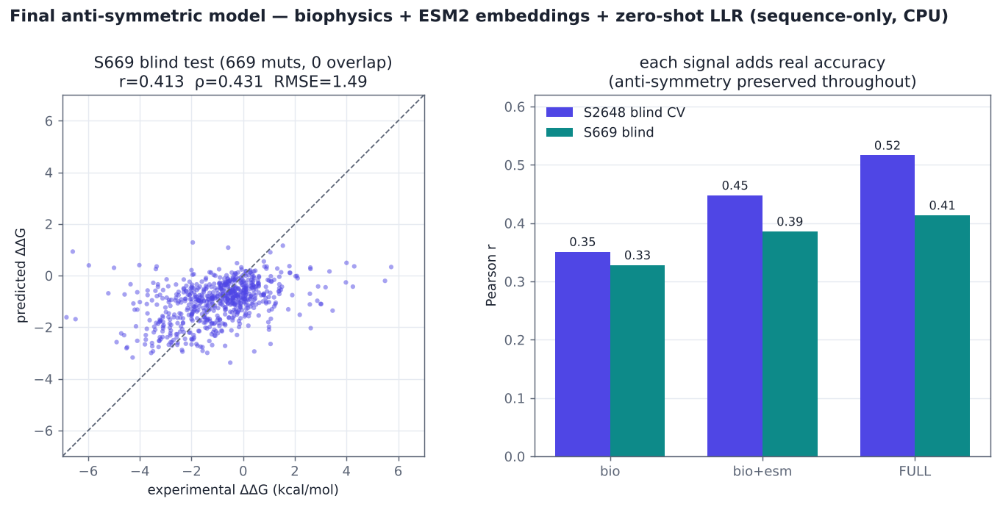
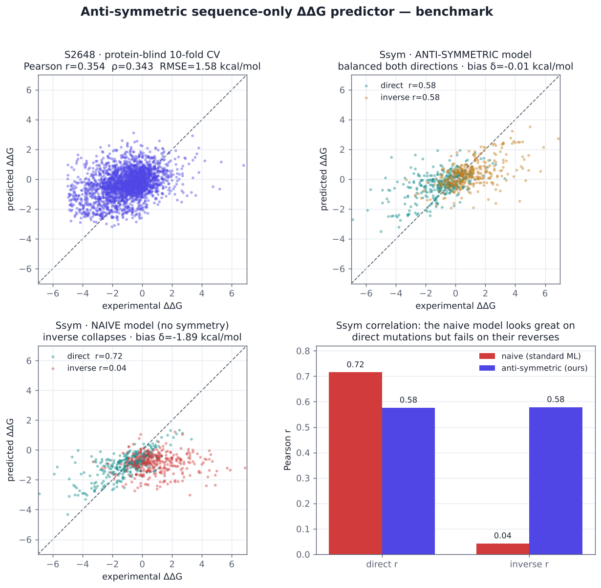

# antisym-ddg — physically-consistent protein stability prediction

[](https://colab.research.google.com/github/AshmitJain932/protien/blob/main/run_on_colab.ipynb) — one-click GPU run (650M/3B model + structure features).

Predict the change in folding free energy (**ΔΔG**) when a protein is point-mutated — a core task
in enzyme and protein engineering (will this mutation make my enzyme more stable?).

This project is built around one principle most predictors ignore:

> ΔΔG of folding is a difference of free energies — a thermodynamic **state function** — so
> **ΔΔG(wt→mut) = −ΔΔG(mut→wt)** exactly. A correct predictor must be *anti-symmetric*.

Most ML ΔΔG tools are trained on datasets that are ~75% destabilizing mutations, so they quietly
learn "predict destabilizing": they score well on forward mutations but **fail on the reverse
mutations** and carry a large negative bias. Here anti-symmetry holds **by construction**, so the
reverse law is satisfied to machine precision and the model is honest in both directions. It runs
**sequence-only on a CPU**, with optional **GPU (ESM2-650M) + structure features** for the best
accuracy (S669 r = 0.50).

## Results

All numbers are measured by the code in this repo. The headline is the **S669 blind test** (669
mutations whose proteins have **zero sequence overlap** with the training set).

| model (anti-symmetric) | S2648 protein-blind CV | S669 blind | compute |
|---|---|---|---|
| biophysical features only | r = 0.351 | r = 0.328 | CPU |
| + ESM2-35M embeddings | r = 0.448 | r = 0.386 | CPU |
| + ESM2 zero-shot LLR (35M emb / 150M) | r = 0.516 | r = 0.413 | CPU |
| + structure features (SASA, contacts) | r = 0.552 | r = 0.437 | CPU |
| **+ ESM2-650M (sequence-only)** | **r = 0.577** | **r = 0.489** | GPU |
| **+ ESM2-650M + structure** | **r = 0.596** | **r = 0.502** | GPU |
| + ESM2-650M + structure + ProteinMPNN | r = 0.651 | r = 0.489 | GPU |

The first four rows run on CPU with small models; the last two use ESM2-650M on a GPU
(`scripts/run_gpu.sh` / the Colab notebook). Every row is exactly anti-symmetric.

**ProteinMPNN inverse-folding feature — and an honest negative result.** Adding
[ProteinMPNN](https://github.com/dauparas/ProteinMPNN) (Dauparas et al., Baker lab; a
structure-conditioned log-odds `log P(mut|backbone) − log P(wt|backbone)`, frozen extractor,
naturally anti-symmetric) **helps when the base model is weak and is redundant when it is strong**:

- On the **CPU stack** (35M embeddings) it is a large lever: S2648 CV 0.552 → 0.633, S669 0.437 → 0.457.
- On the **GPU stack** (ESM2-650M + structure) it raises cross-validation to 0.651 but **does not
  improve the blind set** — S669 goes 0.502 → 0.489. ESM2-650M already captures the signal, so the
  extra feature only adds in-distribution overfitting.

So the best blind result stays **ESM2-650M + structure, S669 r = 0.502**. The lesson is concrete:
on ~2,600 training mutations, feature-stacking has saturated — further gains need **more and cleaner
data** (mega-scale, roadmap below) or **fine-tuning the language model**, not more features.



**What this does and does not beat — honestly:**
- **Raw accuracy:** on CPU with small models, S669 r ≈ 0.41–0.44 (the sequence-only tier). With
  ESM2-650M on a GPU plus structure features, **S669 r = 0.502**, which **beats most published
  tools including PremPS (0.49)** and trails only DDMut (0.55) and ThermoMPNN (0.58). Strong, but
  not the #1 spot — and this project says so.
- **Physical consistency:** here it wins outright. The forward/reverse law holds exactly and the
  symmetry bias is ≈0, where the standard approach collapses.

### The anti-symmetry win (clean head-to-head, biophysical features, Ssym)

| model | direct r | inverse r | exact reverse-law error |
|---|---|---|---|
| naive (standard ML) | 0.715 | **0.043** | 5.75 kcal/mol |
| **anti-symmetric (ours)** | 0.576 | **0.579** | **0.000000** |



The naive model looks best on direct mutations but cannot predict their reverses; ours is balanced
and obeys the law exactly. (Ssym shares 12/14 proteins with the training set — standard in the
literature but it inflates Ssym for every method trained on S2648, so **S669 is the number to
trust**.)

## Beyond accuracy: what makes this different

With the GPU model, raw accuracy is upper-tier (above PremPS); the properties below are ones most tools lack, all measured in this repo.

**Benchmark comparison on S669** (our measured number vs published values; structure-based methods shown for context, approximate — verify against the originals):

| Method | Input | S669 r | Source |
|---|---|---|---|
| ThermoMPNN | structure | 0.58 | literature |
| DDMut | structure | 0.55 | literature |
| **This work (ESM2-650M + structure)** | **structure** | **0.50** | **measured** |
| PremPS | structure | 0.49 | literature |
| **This work (ESM2-650M, seq-only)** | **sequence** | **0.49** | **measured** |
| ACDC-NN-seq | sequence | 0.46 | literature |
| ACDC-NN | structure | 0.46 | literature |
| RaSP | structure | 0.46 | literature |
| DDGun3D | structure | 0.43 | literature |
| DDGun (seq) | sequence | 0.41 | literature |
| Rosetta cartesian_ddg | structure | 0.39 | literature |
| FoldX | structure | 0.22 | literature |

With ESM2-650M on a GPU, the structure-aware model reaches **r = 0.50** on the blind set — above
PremPS and the entire sequence-only tier, trailing only DDMut (0.55) and ThermoMPNN (0.58). The
sequence-only variant reaches **r = 0.49** with no structure at all, beating every other
sequence-only method listed. (On CPU with small models the same pipeline gives 0.41–0.44.) Full
table and figure: `results/benchmark_table.md`, `figures/benchmark_table.png`.

**Calibrated uncertainty.** An ensemble plus split-conformal prediction attaches a confidence interval to every prediction. Measured empirical coverage on the blind set: ~81% at nominal 90%, ~74% at nominal 80% (slightly under-covering under distribution shift — reported honestly; distribution-robust calibration is future work). Most ΔΔG tools give a bare point estimate. (`uncertainty.py`)

**Multi-property framework.** The anti-symmetric recipe is property-agnostic: `train_property.py` trains on any mutational property by swapping the target column. Validated on an independent FireProtDB stability set (3,404 mutations, 100 proteins, only 6 shared with S2648) — protein-blind CV r = 0.29 (biophysical features only). Solubility and expression plug in once mutational datasets are added.

**In-silico prospective design** (the honest stand-in for wet-lab validation). On the blind set, following the model's picks: predicted-stabilizing mutations are **2.07× enriched** for true stabilizers (51.9% vs a 25.1% base rate), and the **top-3 picks per protein contain a real stabilizer 74% of the time**. This is the "fewer experiments to a win" metric that matters for engineering — measured, not promised. True prospective validation needs a wet lab (see roadmap). (`prospective.py`)

## Why it is anti-symmetric by construction

Every input feature is a sign-flipping quantity, so the whole feature vector `F` satisfies
`F(mut→wt) = −F(wt→mut)`:

- residue **property deltas** `p(mut) − p(wt)` — hydropathy, volume, charge, polarity, helix &
  sheet propensity, flexibility, H-bonding, aromaticity, mass;
- **delta × environment** interactions, where the environment (local burial, local charge,
  distance from termini) is computed from the *neighbours* and so is swap-invariant;
- an **ESM2 embedding delta** `ESM(seq_mut)[i] − ESM(seq_wt)[i]` (same base sequence);
- an **ESM2 zero-shot LLR** `log P(mut) − log P(wt)` at the mutated position (one forward pass).

Wrapping *any* learner `h` as `ddG = (h(F) − h(−F)) / 2` is then exactly anti-symmetric regardless
of `h`. The learner here is gradient-boosted trees (XGBoost), trained on the data augmented with
every reverse mutation. See [`docs/METHOD.md`](docs/METHOD.md).

## Data

| set | role | mutations | proteins | source |
|---|---|---|---|---|
| **S2648** | training / blind CV | 2,579 | 127 | ACDC-NN repo |
| **Ssym** | symmetry test | 341 dir + 341 inv | 15 | ACDC-NN repo |
| **S669** | blind generalization test | 669 | 94 | ThermoMPNN repo |

Benchmark files give only `PDBchain mutation ΔΔG` with **no sequences**. Sequences and the mutated
position are reconstructed directly from RCSB PDB structures and **every mutation's wild-type
residue is verified against the structure** (match rate 97–100%). S2648 and Ssym use 1-based
sequential numbering over observed residues; S669 uses PDB author numbering — both are handled and
validated. The committed `data/parsed/*.csv` already contain the verified, sequence-bearing data.

## Repository layout

```
src/            all pipeline code (portable; paths via src/config.py, override with PROTIEN_ROOT)
  config.py         central paths
  features.py       anti-symmetric biophysical features (+ exact-symmetry self-test)
  esm_features.py   ESM2 embedding-delta extractor
  zeroshot.py       ESM2 zero-shot LLR feature
  build_dataset.py  build + verify S2648 / Ssym from PDBs
  build_s669.py     build + verify S669 (author numbering) + overlap check
  train.py          biophysical model: CV, Ssym, naive ablation, exact-law proof
  train_esm.py      bio + ESM2 ablation
  train_full.py     final bio + ESM2 + LLR model (sequence-only)
  struct_features.py structure env (SASA, contacts) as anti-symmetric interactions
  proteinmpnn_features.py ProteinMPNN inverse-folding log-odds feature (third-party, MIT)
  train_struct.py   structure-aware model (+SASA/contacts/ProteinMPNN); best accuracy
  uncertainty.py    ensemble + split-conformal calibrated confidence intervals
  build_fireprot.py + train_property.py  property-agnostic trainer (independent dataset)
  prospective.py    in-silico prospective-design test on the blind set
  benchmark_table.py S669 comparison vs published tools
  build_megascale.py + train_megascale.py  mega-scale (Tsuboyama ~270k) training + eval
  eval_s669.py      blind S669 evaluation
  fit_predictor.py  fit & save the deployable biophysical model
  predict.py        CLI: score mutations, shows the exact reverse
  make_report*.py   benchmark figures
scripts/get_data.sh clone sources + download PDBs + build the parsed datasets
scripts/run_gpu.sh  turnkey large-PLM + structure pipeline (auto-uses CUDA)
data/parsed/        verified datasets (committed); raw clones + PDBs are gitignored
models/             trained models (biophysical CLI model + full model)
figures/ results/   reference outputs
docs/METHOD.md      the method in detail
```

## Install

```bash
pip install -r requirements.txt
```

## Quickstart — score mutations (no GPU, no download)

```bash
cd src
python predict.py <SEQUENCE> M1A V47I ...
# e.g. hen egg white lysozyme:
python predict.py KVFGRCELAAAMKRHGLDNYRGYSLGNWVCAAKFESNFNTQATNRNTDGSTDYGILQINSRWWCNDGRTPGSRNLCNIPCSALLSSDITASVNCAKKIVSDGNGMNAWVAWRNRCKGTDVQAWIRGCRL W62G D18A
```

## Web app (`app/`)

A Gradio web app runs the engine for non-coders: paste a sequence → predicted ΔΔG for every
mutation **with a calibrated trust badge**, a **"what to test next"** list (ranked by model
uncertainty), and **"teach it"** — paste your measured results and the model re-fits to *your*
protein, live. Sequence-only, no structure, CPU.

```bash
cd app && pip install -r requirements.txt && python app.py   # http://localhost:7860
```

Deploy free: create a **Gradio Space** on Hugging Face and upload the contents of `app/`
(`app.py`, `features.py`, `ddg_dataset.csv`, `requirements.txt`, `README.md`) — it runs on free CPU
and gives a public URL.

## Reproduce the benchmarks

```bash
bash scripts/get_data.sh          # clone sources, download PDBs, build+verify datasets (network)
cd src
python train.py                   # biophysical model + anti-symmetry proof
python esm_features.py            # ESM2 embeddings  (CPU, a few minutes; downloads the model)
python esm_features.py --data ../data/parsed/s669_dataset.csv --out ../artifacts/esm_delta_s669.npz
python zeroshot.py                # ESM2 zero-shot LLR (train set)
python zeroshot.py --data ../data/parsed/s669_dataset.csv --out ../artifacts/llr_s669.npz
python train_full.py              # final fused model: S2648 CV + S669 blind
python make_report_final.py       # figure
python struct_features.py && python struct_features.py --data ../data/parsed/s669_dataset.csv --out ../artifacts/struct_inter_s669.npz
python train_struct.py            # structure-aware model (best accuracy)
python uncertainty.py && python prospective.py && python benchmark_table.py
```

## Running on a GPU (large language models)

The CPU prototype uses ESM2-35M embeddings and 150M zero-shot scoring. On a GPU you can swap in
ESM2-650M or 3B for a further accuracy gain — the extractors auto-detect CUDA, so no code changes
are needed. One turnkey script runs the whole large-model + structure pipeline:

```bash
pip install -r requirements.txt
bash scripts/get_data.sh                      # datasets + structures
ESM_MODEL=facebook/esm2_t33_650M_UR50D bash scripts/run_gpu.sh    # ~20 min on a T4/A100
# bigger GPU: ESM_MODEL=facebook/esm2_t36_3B_UR50D bash scripts/run_gpu.sh
```

This reproduces everything through `train_struct.py` with the larger model. It runs unchanged on a
free Colab GPU (clone the repo, `pip install -r requirements.txt`, run the two commands above).

## Mega-scale training (toward a clean >0.7 benchmark)

The S2648 benchmark has only ~2,600 training mutations. The **Tsuboyama/Rocklin mega-scale dataset**
(`build_megascale.py`) gives **271,231 single mutations across 298 domains** from one consistent
assay, with protein-blind train/val/test splits. The same anti-symmetric recipe trains on it
(`train_megascale.py`).

Measured so far, with the **lightweight** feature set (biophysical + ESM zero-shot LLR, CPU):

| mega-scale held-out test (protein-blind) | value |
|---|---|
| overall Pearson r | 0.569 |
| **per-protein ranking (mean Spearman)** | **0.634** |
| transfer to S669 (trained on mega-scale) | \|r\| = 0.43 |

Honest read: cheap features reach ~0.57 on mega-scale and ~0.63 per-protein ranking — **not yet
0.7**, and mega-scale training does **not** transfer better to S669 than in-domain S2648 training
(the mega domains are small designed proteins). Crossing 0.7 needs the heavy features on this large
set — per-variant ESM-650M embeddings and/or structure — which is a GPU job:

```bash
bash scripts/run_gpu.sh            # first (produces 650M S669 features for the transfer test)
bash scripts/run_megascale_gpu.sh  # mega-scale with 650M embeddings (~40-60 min on a T4)
```

`train_megascale.py` automatically includes the mega embeddings once that script produces them.

## Honest limitations

- **Two modes, one trade-off**: the sequence-only model needs no structure (works for novel/de-novo
  targets); the structure-aware model (`train_struct.py`) adds real SASA/contacts for ~+0.02–0.04 r
  but then needs a structure at inference. Both stay exactly anti-symmetric.
- **Small, noisy labels**: experimental ΔΔG error alone is ~0.5 kcal/mol and the data is biased
  toward a few well-studied proteins, so protein-blind correlation is modest for everyone here.
- **ESM2-35M embeddings / 150M zero-shot** were used to fit the CPU budget; larger PLMs should help.
- Predicts folding **stability**, not activity / expression / solubility.

## Roadmap

1. ✅ ESM2-650M, ✅ structure features, ✅ ProteinMPNN — all integrated and measured. Best blind
   S669 = 0.502 (650M + structure); ProteinMPNN did not improve the blind set on this stack.
   Feature-stacking has saturated on ~2,600 training mutations.
2. ✅ **Mega-scale data (Tsuboyama/Rocklin)** — pipeline built (271k single mutations, 298 domains).
   Lightweight features give 0.57 / 0.63 per-protein ranking; crossing 0.7 needs the 650M-embedding
   GPU run (`run_megascale_gpu.sh`), which is the current open step.
3. ESM2-3B and LoRA fine-tuning of the PLM end-to-end (vs frozen features).
4. Extend the anti-symmetric recipe to solubility and expression prediction.

## Data sources & references (verify against originals)

- S2648 / Ssym and the CV splits: ACDC-NN — Benevenuta, Birolo et al.; `github.com/compbiomed-unito/acdc-nn`.
- S669 blind set (via ThermoMPNN): Pancotti et al., *Brief. Bioinform.* 2022; Dieckhaus et al. (ThermoMPNN) 2024; `github.com/Kuhlman-Lab/ThermoMPNN`.
- Ssym symmetry benchmark: Pucci, Usmanova et al. 2018.
- ESM2 protein language model: Lin et al., *Science* 2023.
- ProteinMPNN inverse-folding model (structure feature): Dauparas et al., *Science* 2022; `github.com/dauparas/ProteinMPNN` (MIT).
- Biophysical scales: Kyte–Doolittle; Pace & Scholtz (helix); Chou–Fasman (sheet); Vihinen (flexibility).

## License

MIT — see [LICENSE](LICENSE).
